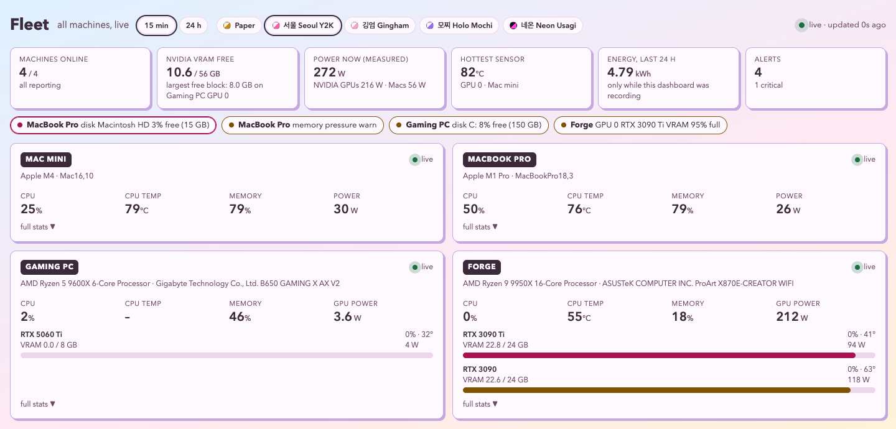
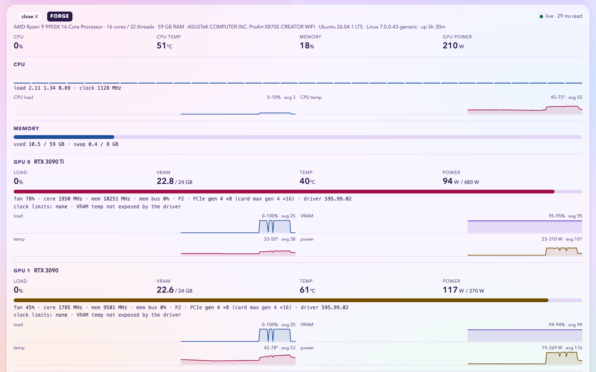

# Fleet Dashboard: live GPU, CPU and temperature monitoring for every Mac, Linux and Windows machine

**One self-hosted web page for your whole homelab.** See every NVIDIA GPU's VRAM, temperature, watts, fan and clock
throttling, which process is holding each GPU, the models Ollama and vLLM have loaded, and Apple Silicon temperatures,
fans and power (no sudo), next to CPU per core, memory, disks and network for every machine you own. It updates every
3 seconds, keeps 24 hours of history, and runs on any always-on machine you can open from your phone.

Zero dependencies: Python standard library only, no Docker, no database, and **nothing installed on the machines it
watches**. Each one is read over SSH with the keys you already have.



## Why we built it

We run local LLMs across a few Macs and a couple of NVIDIA boxes, and kept SSHing into each one to run `nvidia-smi`,
`top` and a temperature tool, one terminal per machine. We wanted one page that answers "which GPU has room for
this model, and is anything running hot?" at a glance, from a phone, without installing an agent, a database and a
Grafana stack on every machine. None of the tools we checked treated Macs as first-class machines next to Linux and Windows
GPU boxes, so we built it: in a day, with [Claude Code](https://claude.com/claude-code) (Claude Fable 5.2 and Claude
Opus 5.5). It is part of [LoveSpark](https://github.com/Joona-t), free and open-source tools for neurodivergent people.

## Features

- **NVIDIA GPUs** (Linux and Windows): load, VRAM used and free, temperature, power against its limit, fan, core and
  memory clocks, PCIe link, P-state, and **clock-throttle reasons** (power cap, thermal, power brake).
- **VRAM per process**: which program holds how much memory on which card, and the models loaded in **Ollama** or
  **vLLM**.
- **Apple Silicon** (macOS): per-core CPU (efficiency and performance cores), CPU and GPU die temperatures from the SMC,
  whole-machine watts, fans, GPU load and memory pressure, all **without sudo**.
- **Every machine**: CPU per core, memory and swap, disks, disk and network throughput, top processes by CPU and memory.
- **Fleet totals**: machines online, NVIDIA VRAM free and the largest free block, power now, the hottest sensor,
  energy over 24 hours.
- **Alerts**: hot GPU or CPU, VRAM or memory nearly full, low disk, a stopped fan at temperature, thermal throttling,
  a machine offline.
- **15-minute and 24-hour charts**, history kept on disk, so a restart loses nothing.
- **2x2 layout**: one machine per corner; tap a machine for its full stats. Seven themes: Paper, four Korean ones
  (서울 Seoul Y2K, 깅엄 Gingham, 모찌 Holo Mochi, the dark 네온 Neon Usagi), and Cream and the dark Basalt
  from LoveSpark's Glyph Grid Studio (Cinzel and EB Garamond, film grain).
- **Laptops welcome**: a laptop pushes its readings while it is around instead of having to be reachable.



## Quick start

On one Mac or Linux machine, this shows that machine:

```bash
git clone https://github.com/Joona-t/lovespark-fleet-dashboard
cd lovespark-fleet-dashboard
python3 fleet_dashboard.py
```

Open http://127.0.0.1:8766.

### Your whole fleet

1. Give the server machine SSH access to the others (key login, an alias for each in `~/.ssh/config`).
2. Copy `devices.example.json` to `devices.json` and list your machines:

   ```json
   [
     {"id": "mini",    "label": "Mac mini",  "kind": "mac",  "ssh": "my-mini"},
     {"id": "laptop",  "label": "MacBook",   "kind": "mac",  "ssh": null, "push_from": "laptop"},
     {"id": "pc",      "label": "Gaming PC", "kind": "win",  "ssh": "my-pc"},
     {"id": "gpu-box", "label": "GPU box",   "kind": "auto", "ssh": ["gpu-box-linux", "gpu-box-windows"]}
   ]
   ```

   `kind` is `mac`, `linux`, `win`, or `auto` (asked with `uname` on every connect, for a dual-boot machine). `ssh` can
   be a list of aliases tried in turn, one per OS, since each install has its own host key. `devices.json` is in
   `.gitignore`.
3. Start it on the machine that stays on, saying which device it is:

   ```bash
   python3 fleet_dashboard.py --here mini --host 0.0.0.0
   ```

4. Keep it running (macOS, launchd: starts at login, restarts if it stops):

   ```bash
   ./install.sh server mini my-mini.your-tailnet.ts.net
   ```

   The extra names are DNS names the page may be opened under, such as a Tailscale name.
5. On a laptop, push its readings to the server whenever it is on the network:

   ```bash
   ./install.sh push my-mini laptop
   ```

Requirements on the watched machines: SSH; `python3` on Linux; the system `/usr/bin/python3` on macOS (Xcode Command
Line Tools); Windows PowerShell 5.1 and the OpenSSH server on Windows; the NVIDIA driver where there are NVIDIA GPUs.

## How it works

```
agent on each machine  --one JSON line every 3 s-->  one reader thread per machine  -->  state + history
agent_mac.py    macOS, local or piped over SSH                                           |-- /events      Server-Sent Events
agent_linux.py  Linux, piped over SSH into python3                                       |-- /api/state   JSON snapshot
agent_win.ps1   Windows, piped over SSH into PowerShell                                  `-- history/<date>.jsonl
```

The server pipes each agent's source over SSH into the interpreter that is already there, so nothing is copied or
installed. An agent lives as long as its SSH session and at most 10 minutes, then the server starts a fresh one.
Sources: on Linux `/proc`, `/sys/class/hwmon`, RAPL and NVIDIA's NVML library through `ctypes` (with `nvidia-smi` as a
fallback); on macOS the SMC, IOHID and IOReport through `ctypes`; on Windows CIM performance counters and `nvidia-smi`.

## Performance (measured)

CPU an agent costs the machine it watches, per 3-second tick:

| Machine | Cost | Notes |
|---|---|---|
| Linux, 32 threads, two RTX 3090s | **16 ms** (0.5% of one core) | was 56 ms; NVML instead of two `nvidia-smi` launches cut 45 ms to 2 ms |
| Mac mini (M4) | ~61 ms | SMC and IOReport in-process; slow sensors every third tick |
| Windows, 12 threads, RTX 5060 Ti | ~78 ms including WMI (~1.55 s a minute) | |

In the browser, one live update takes under 1 ms of script in the grid and about 2 ms with a machine's full stats
open, and reaches the screen within the next two frames (~25 ms at 60 Hz) in every theme; themes make no measurable
difference (`bench/page_latency.mjs`, 5 rounds, ~30 updates per theme).

We also measured the design itself against polling over a new SSH connection every tick (68 ms, 3x the latency) and
over a reused connection (57 ms): streaming one session is as cheap as the best polling and the freshest. The scripts
are in [`bench/`](bench/) and the write-up in [BENCHMARKS.md](BENCHMARKS.md).

## Security

- The page has no login: keep it on your home network or a private network such as Tailscale.
- The server answers only an IP address, `localhost` or its own names in the `Host` header (DNS-rebinding protection);
  `--allow-host` adds a name.
- Agent output is treated as untrusted: every sample is rebuilt against a schema and the page escapes everything it
  shows.

## How it compares

| | Fleet Dashboard | [Netdata](https://www.netdata.cloud) | [Beszel](https://beszel.dev/guide/gpu) | [homelab-monitor](https://github.com/SikamikanikoBG/homelab-monitor) |
|---|---|---|---|---|
| Installed on each watched machine | nothing (piped over SSH) | an agent | an agent | nothing (probe over SSH) |
| Apple Silicon sensors and power | yes, no sudo | not documented | experimental, opt-in | not mentioned |
| NVIDIA VRAM per process | yes | not documented | not documented | yes |
| What the server needs | Python standard library | the Netdata agent | the Beszel hub | Docker, Python packages |

Marked cells come from each project's own pages as of November 2026; "not documented" means we did not find it, not
that it is missing. Use Netdata or Grafana for long retention, many hosts or a team; use this for a handful of machines you own,
Macs included, with nothing to install.

## Build your own with Claude Code

This is the prompt the first version came from. Paste it into [Claude Code](https://claude.com/claude-code):

```
Build me one live dashboard for every machine I own. Python standard library only, no dependencies.

1. One tiny agent per OS prints one line of JSON every 3 s: CPU per core and temp, memory, every GPU (load, VRAM, temp,
   watts, fan, clocks, throttle reasons), VRAM per process, disks, network, top processes, loaded Ollama models.
- macOS: SMC sensors and IOReport power through ctypes, no sudo
- Windows: PowerShell, nvidia-smi, CIM counters, no admin
- Linux: /proc, /sys/class/hwmon, NVML through ctypes

2. The server pipes each agent over SSH, so nothing gets installed on the other machines. Agents exit when the SSH
   session drops.

3. One page over Server-Sent Events: a 2x2 grid with one machine per corner, tap one for its full stats, 15 min and
   24 h charts, alerts for heat, VRAM, memory and disk.

4. A laptop pushes its readings into a named pipe instead of being polled.

5. Treat agent output as untrusted: rebuild every sample against a schema, escape everything on the page, refuse
   foreign Host headers.

6. Run it 24/7 on an always-on machine (launchd) and open it from anywhere over Tailscale. Write tests for all of it.
```

## FAQ

**How do I monitor GPU temperature and VRAM on several machines at once?** List them in `devices.json` and open one
page; every NVIDIA GPU on every machine shows its temperature, VRAM, power and the processes using it.

**Can I see Apple Silicon (M1, M2, M3, M4) CPU temperature and power without sudo?** Yes. The macOS agent reads the
SMC and IOReport directly through `ctypes`, as your user.

**Does it need root, admin or Docker?** No. Linux CPU package watts (RAPL) need root on some kernels and are left
out when unreadable.

**Does it work with Ollama, vLLM or llama.cpp?** Loaded Ollama and vLLM models are listed; any process holding GPU
memory (llama.cpp's `llama-server` included) shows in the per-process VRAM table.

**Can I open it on my phone?** Yes: run the server with `--host 0.0.0.0` and open it over your LAN or Tailscale.

## Tests

```bash
python3 -m unittest test_fleet
```

40 tests: the parsers against real recorded output from macOS, Linux and NVIDIA drivers, a fuzz test that no agent
output can break the stream or reach the page as markup, the Host check, and the Windows agent's start command.

## License

[MIT](LICENSE). Free, no ads, no data collection: everything stays on your machines.
